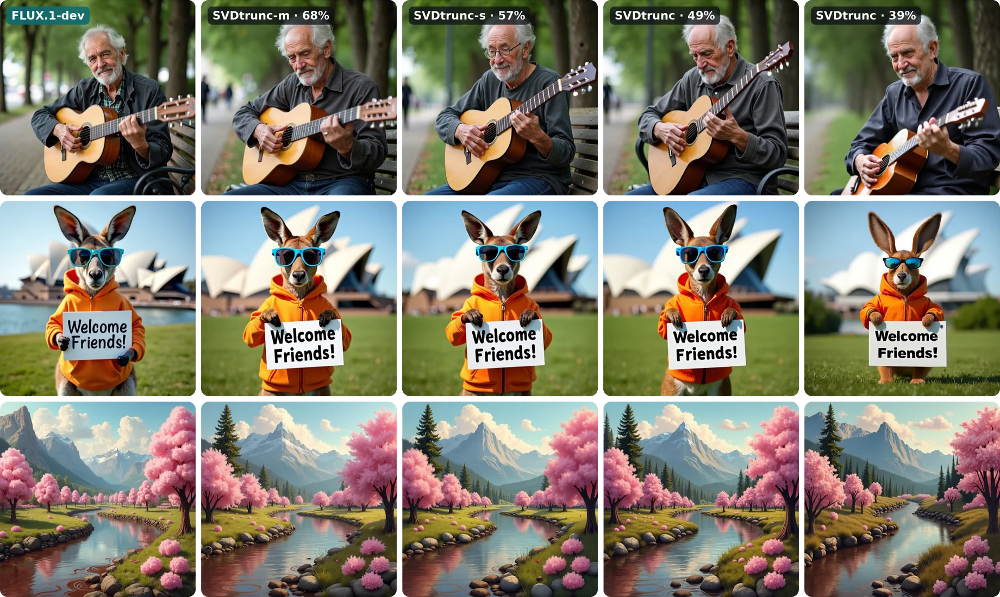

# SVDtrunc: Importance-Aware Low-Rank Distillation of Diffusion Transformers

[**Denis Zavadski**](https://sipirius.github.io/)<sup>1,2,\*</sup>, **Sebastian Heid**<sup>1,2,\*</sup>, Damjan Kalšan<sup>1</sup>, [Stefan Roth](https://www.visinf.tu-darmstadt.de/visual_inference/people_vi/stefan_roth.en.jsp)<sup>2,3,4</sup>, [Carsten Rother](https://hci.iwr.uni-heidelberg.de/vislearn/people/carsten-rother/)<sup>1,2</sup>

<sub><sup>1</sup>Heidelberg University · <sup>2</sup>Zuse School ELIZA · <sup>3</sup>TU Darmstadt · <sup>4</sup>hessian.AI · <sup>\*</sup>Equal contribution</sub>


[](https://arxiv.org/abs/2609.04646)
[](https://vislearn.github.io/SVDtrunc/)
[](https://huggingface.co/CVL-Heidelberg/SVDtrunc)


<sub>Each row uses the same prompt: FLUX.1-dev on the left, then SVDtrunc at 68%, 57%, 49% and 39% of its transformer
parameters. SVDtrunc-m and SVDtrunc-s are the 68% and 57% models released here.</sub>

This repository contains the compressed models, the code to run them, and the code to compress FLUX.1 yourself.

## Abstract

Diffusion Transformers (DiTs) have emerged as a dominant architecture for high-quality
text-to-image generation, yet their scale poses challenges for efficient deployment. While
truncated singular value decomposition (SVD) is a principled tool for parameter reduction,
evidence from large language models (LLMs) suggests that naive low-rank approximation can cause
catastrophic failure. In contrast, we find that truncated SVD in DiTs produces smooth degradation
even under substantial global compression, with redundancy distributed across projection matrices
throughout the whole network rather than concentrated in a few transformer blocks.

Building on these insights, we introduce *SVDtrunc*, a two-step block-level compression scheme,
first allocating ranks across blocks and compressing the least important ones via truncated SVD
under a global parameter budget, and then fine-tuning all blocks with modular knowledge
distillation and a rectified-flow objective.

We apply SVDtrunc to FLUX.dev across compression levels ranging from 40% to 90% of the original
parameter count. Across three benchmarks, GenEval, HPSv2, and DPG, we outperform all competing
approaches. Notably, and in contrast to prior work, we retain near-full performance at 68% and
remain competitive even at 57% of the original parameter budget. Furthermore, we show that
SVDtrunc complements step distillation and achieves strong results even without fine-tuning,
positioning it as a practical continuation of efficiency improvements beyond diffusion step
reduction for large-scale generative models.

## Results

Compression of FLUX.dev, where *R* is the mean quality reduction across GenEval, HPSv2 and DPG
relative to the uncompressed model.

| Method | Params ↓ | GenEval ↑ | HPSv2 ↑ | DPG ↑ | *R* ↓ |
|---|---|---|---|---|---|
| FLUX.dev | 100% | 0.647 | 31.70 | 83.9 | 0.00 |
| PPCL (CVPR '26) | 68% | 0.605 | n/a | 80.0 | 5.55 |
| **SVDtrunc-m** | **68%** | **0.645** | 31.27 | **83.4** | **0.75** |
| **SVDtrunc-s** | **57%** | 0.616 | 31.22 | 82.6 | **2.60** |

See the [project page](https://vislearn.github.io/SVDtrunc/) for the full comparison, the
training-free setting, and results on step-distilled FLUX.schnell.

## Models

| Model               | Base model     | Transformer parameters | Checkpoint                                                               |
| ------------------- | -------------- | ---------------------- | ------------------------------------------------------------------------ |
| SVDtrunc-m          | FLUX.1-dev     | 8.1B (68%)             | `CVL-Heidelberg/SVDtrunc/FLUX.1-dev/svdtrunc-m.safetensors`              |
| SVDtrunc-s          | FLUX.1-dev     | 6.8B (57%)             | `CVL-Heidelberg/SVDtrunc/FLUX.1-dev/svdtrunc-s.safetensors`              |
| SVDtrunc-schnell-70 | FLUX.1-schnell | 8.3B (70%)             | `CVL-Heidelberg/SVDtrunc/FLUX.1-schnell/svdtrunc-schnell-70.safetensors` |

The weights are on Hugging Face at [CVL-Heidelberg/SVDtrunc](https://huggingface.co/CVL-Heidelberg/SVDtrunc). The text
encoders and the autoencoder are those of the base model, unchanged.

## Setup

Python 3.12 or newer and a CUDA GPU. The compressed models need about 16–20 GB of GPU memory at 1024 × 1024,
FLUX.1-dev itself about 26 GB.

```bash
git clone https://github.com/vislearn/SVDtrunc && cd SVDtrunc
uv sync                 # or: pip install -e .
```

Weights download from the Hugging Face Hub on first use. The models based on FLUX.1-dev load its text encoders and
autoencoder from [FLUX.1-dev](https://huggingface.co/black-forest-labs/FLUX.1-dev), which is gated: accept its
license on the Hub and log in with `hf auth login`.

## Generating images

```bash
uv run svdtrunc generate --checkpoint CVL-Heidelberg/SVDtrunc/FLUX.1-dev/svdtrunc-m.safetensors \
    --prompt "a red fox sitting in fresh snow, golden hour" --output-dir outputs
```

`--checkpoint` takes a local file or a Hub file written `<owner>/<repo>/<file>`. Repeat `--prompt` for several
images, or pass `--prompts prompts.txt` with one prompt per line. Image `i` uses seed `--seed + i`.

The base model is detected from the checkpoint, and the defaults follow it: 50 steps with guidance 3.5 for
FLUX.1-dev models, 4 steps for FLUX.1-schnell models. `--steps`, `--guidance`, `--height` and `--width` override
them.

From Python:

```python
from svdtrunc.loading import detect_base, load_ae, load_flux, load_text_encoders
from svdtrunc.render import encode_prompts, render, save_images

checkpoint = "CVL-Heidelberg/SVDtrunc/FLUX.1-dev/svdtrunc-m.safetensors"
base = detect_base(checkpoint)  # FLUX.1-dev or FLUX.1-schnell, with its sampling defaults

t5, clip = load_text_encoders(base, device="cuda")
txt, vec = encode_prompts(t5, clip, ["a red fox sitting in fresh snow, golden hour"])
del t5, clip  # frees about 10 GB before the transformer is loaded

model = load_flux(checkpoint, device="cuda")
ae = load_ae(base.ae, device="cuda")
images = render(model, ae, txt, vec, seeds=[0], steps=base.steps, guidance=base.guidance, shift=base.shift)
save_images(images, ["fox.png"])
```

## Compressing FLUX.1

Compressed checkpoints are ordinary safetensors files. Their metadata records which layers are low-rank and at what
rank, so `load_flux` rebuilds the right structure. `describe` prints it per block:

```bash
uv run svdtrunc describe CVL-Heidelberg/SVDtrunc/FLUX.1-dev/svdtrunc-m.safetensors
```

All compression below is truncated SVD of the dense weights, without fine-tuning.

### The structure of a released model

```bash
uv run svdtrunc compress --like CVL-Heidelberg/SVDtrunc/FLUX.1-dev/svdtrunc-m.safetensors --output trimmed.safetensors
```

This truncates the matching base model (here FLUX.1-dev) to the same ranks as SVDtrunc-m.

### Your own compression ratios

Every linear layer of a block can be truncated to remove a given fraction of its weights. A layer with `n` outputs
and `m` inputs keeps rank `ceil(n·m·(1 − c) / (n + m))` for a compression ratio `c`.

```python
from svdtrunc.compression import compress, describe, ratio_block_spec
from svdtrunc.loading import load_flux, save_flux
from svdtrunc.spec import CompressionSpec

model = load_flux("black-forest-labs/FLUX.1-dev/flux1-dev.safetensors", device="cuda")
ratios = {"double_blocks.5": 0.6, "double_blocks.13": 0.6, "single_blocks.20": 0.4}
linears = dict(describe(model).linears)
for block, ratio in ratios.items():
    linears |= ratio_block_spec(model, block, ratio)
compress(model, CompressionSpec(linears))
save_flux(model, "custom.safetensors")
```

`ratio_block_spec` also takes `groups`, e.g. `groups=["img_attn", "txt_attn"]`, to compress only some parts of a
block. Compressing an already compressed model truncates it further.

### Importance-aware compression

Each round (Sec. 3.1–3.2 of the paper) probes every block, ranks the blocks, and compresses the least important ones
on a linear schedule to reach a parameter budget:

```bash
# Images of the current model, then one probe per block: that block compressed a further 60%.
uv run svdtrunc render --checkpoint current.safetensors --prompts prompts.txt --output-dir ref
for block in double_blocks.{0..18} single_blocks.{0..37}; do
    uv run svdtrunc render --checkpoint current.safetensors --prompts prompts.txt \
        --probe-block $block --output-dir probes/$block
done

# CMMD of each probe against the reference, per million parameters removed.
uv run svdtrunc rank --checkpoint current.safetensors --reference ref --probes probes --output ranking.json

# Compress the 30 least important blocks, removing 1.19B parameters in total.
uv run svdtrunc schedule --checkpoint current.safetensors --ranking ranking.json \
    --blocks 30 --target 1.19e9 --output next.json
uv run svdtrunc compress --checkpoint current.safetensors --spec next.json --output next.safetensors
```

In the first round, `current.safetensors` is the base model, e.g.
`black-forest-labs/FLUX.1-dev/flux1-dev.safetensors`. The probes are independent and can run in parallel.

## Tests

```bash
uv run pytest    # CPU only, about 10 s
```

## License

The code is released under the [Apache 2.0 license](LICENSE). `src/svdtrunc/flux` is adapted from
[Black Forest Labs' FLUX reference code](https://github.com/black-forest-labs/flux) (Apache 2.0); the changes are
noted at the top of each file.

The weights follow their base model. SVDtrunc-m and SVDtrunc-s are derived from FLUX.1-dev and released under the
[FLUX.1 [dev] Non-Commercial License](https://huggingface.co/black-forest-labs/FLUX.1-dev/blob/main/LICENSE.md).
SVDtrunc-schnell-70 is derived from FLUX.1-schnell and released under the Apache 2.0 license.

## Citation

```bibtex
@inproceedings{zavadski2026svdtrunc,
  title     = {Importance-Aware Low-Rank Distillation of Diffusion Transformers},
  author    = {Zavadski, Denis and Heid, Sebastian and Kal{\v{s}}an, Damjan
               and Roth, Stefan and Rother, Carsten},
  booktitle = {European Conference on Computer Vision (ECCV)},
  year      = {2026}
}
```
